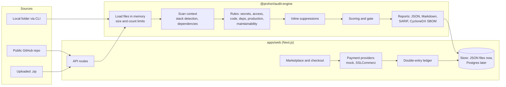

# Prohori architecture

How the system is built today (Phase 0) and where it is going. Business context is in [scenario.md](scenario.md); current status is in [../progress.md](../progress.md).

## Repository layout

```
.
├── progress.md                  continuity file: status, next steps, how to resume
├── README.md                    quick start
├── docs/                        research, scenario, architecture (this file)
├── package.json                 pnpm workspace root (scripts: test, typecheck, dev, scan)
├── pnpm-workspace.yaml
├── tsconfig.base.json
├── packages/
│   └── audit-engine/            @prohori/audit-engine: rules, scoring, reports, SBOM, CLI
└── apps/
    └── web/                     @prohori/web: Next.js app (scan, reports, marketplace, checkout)
```

## System overview



## Audit engine (`packages/audit-engine`)

### Design rules

- **No runtime dependencies.** A security tool should have a small supply chain. The engine uses only Node built-ins.
- **Never executes scanned code.** It reads text files and nothing else.
- **Works in memory.** `scanFiles()` takes a list of files, so the web app can scan a zip without writing it to disk (no path-traversal risk on extraction).
- **TypeScript without a build step.** Node 24 runs `.ts` files directly (type stripping), so tests and the CLI run from source. Rules for this: use `import type` for types, include `.ts` in relative imports, and avoid enums, namespaces and parameter properties. `tsc --noEmit` checks types.

### Pipeline

1. **Load** (`files.ts`): walk a folder or accept in-memory entries. Skip `node_modules`, `.git`, build output and vendored code; skip binary files; cap each file (1 MB for code, 10 MB for lockfiles), the file count (5,000) and total bytes (60 MB). The report says when limits truncated the scan.
2. **Context** (`context.ts`): detect stacks (Next.js, Vite, Express, Supabase, Firebase, Prisma, Laravel, Django, Flask, FastAPI, .NET, AI SDKs, Stripe) and extract dependencies from manifests and lockfiles (`deps/extract.ts`).
3. **Rules** (`rules/*.ts`): each rule has an id, title, category, default severity, CWE reference, description and remediation, plus a `check(ctx)` function that returns raw findings.
4. **Suppressions** (`suppress.ts`): a comment on the same line or the line above, `prohori-ignore <rule-id>: <reason>`, moves a finding to the report's `suppressed` list. A reason is required; without one the suppression is ignored.
5. **Scoring** (`scoring.ts`): see below.
6. **Reports** (`report/*.ts`): JSON (the canonical `AuditReport`), Markdown, SARIF 2.1.0 (for GitHub code scanning) and CycloneDX 1.5 JSON (the SBOM).
7. **Optional vulnerability lookup** (`deps/osv.ts`, `--online`): queries the OSV.dev batch API for resolved dependency versions. Off by default so scans work offline and tests stay deterministic.

### Categories and weights

| Category | Weight | Examples |
|---|---|---|
| `secrets` | 20% | Provider keys, private keys, Supabase service-role tokens, secrets in browser-visible env vars, committed `.env` files |
| `access` | 25% | Supabase tables without row-level security, open Firebase rules, routes and server actions without auth, unprotected AI endpoints, unsigned webhooks, mass assignment |
| `code` | 20% | SQL and command injection, `eval`, raw HTML, disabled TLS checks, open CORS, weak hashing, hard-coded JWT secrets, SSRF, path traversal |
| `dependencies` | 15% | Missing lockfile, unpinned versions, git dependencies, known vulnerabilities (online) |
| `production` | 10% | Debug mode, leaked error details, secrets in logs, no rate limit on login, missing security headers, default passwords |
| `maintainability` | 10% | README, setup steps, `.env.example`, tests, licence, CI, agent guide (`AGENTS.md` / `CLAUDE.md`) |

### Scoring model

- Points per finding: critical 40, high 18, medium 7, low 2, info 0.
- Within a category, the first finding of each rule counts in full; each repeat of the same rule counts 25%, up to 4 repeats. Category score = 100 − deductions, floored at 0.
- Overall score = weighted average of category scores, rounded.
- **Any critical finding caps the overall score at 59.** One leaked live key or one open database is enough to sink an app, and the number should say so.
- Grade: A ≥ 90, B ≥ 80, C ≥ 70, D ≥ 60, F below.
- **Verified gate:** overall ≥ 75 **and** no critical findings. Suppressed findings don't count. Two coverage conditions also apply: the project must contain application code (a README-only repository is not verified), and every check must have run (a check that crashed makes the result incomplete).

### Finding identity

`id` = first 12 hex characters of SHA-1 over rule id, file path and the trimmed matching line. It stays stable across scans as long as that line doesn't change, which later enables "new since last scan" and tracking fixes.

### Secrets handling

Snippets in reports are masked: anything that looks like a secret is cut to its first four characters plus `…`. Reports never contain a full key.

## Web app (`apps/web`)

Next.js 16 (App Router, React 19), server components by default, Node runtime for API routes. Plain CSS with design tokens, no UI framework.

### Pages

| Route | Purpose |
|---|---|
| `/` | Landing page: the problem, what we check, products |
| `/scan` | Scan a public GitHub repo, upload a zip, or run the built-in vulnerable demo |
| `/reports/[id]` | Score, gate result, categories, findings with fixes, downloads (JSON, Markdown, SARIF, SBOM) |
| `/marketplace` | Verified apps only |
| `/marketplace/[slug]` | App details, verification summary, buy (bKash, Nagad, card, international) |
| `/sell` | Builders submit an app; it is scanned and published only if it passes the gate |
| `/checkout/mock/[orderId]` | Simulated payment gateway page (no real money) |
| `/orders/[id]` | Order status and licence key |
| `/dashboard` | Local operator view: orders, revenue, builder balances, recent scans |

### API routes

| Route | Method | Purpose |
|---|---|---|
| `/api/scans` | POST | JSON `{source:"github", url}` or `{source:"demo", sample}`, or multipart with a `file` (zip). Rate-limited per IP |
| `/api/scans/[id]` | GET | Report as `?format=json` (default), `md`, `sarif` or `sbom` |
| `/api/listings` | POST | Submit an app: scan it, publish if verified |
| `/api/checkout` | POST | Create an order and start checkout with the chosen payment method |
| `/api/payments/mock/complete` | POST | The simulated gateway reports success or cancellation through the same signed-callback path a real gateway uses |
| `/api/payments/sslcommerz/ipn` | POST | SSLCommerz instant payment notification, verified with SSLCommerz's validation API |

### Store

Phase 0 keeps data in JSON files under `apps/web/.data/` (git-ignored): `db.json` for scans, listings, orders and ledger entries, plus one file per report. Writes are serialised in-process and written atomically (temp file, then rename). The store sits behind small functions in `lib/store.ts`, so moving to Postgres (Neon) in Phase 1 doesn't touch pages or routes.

### Payments and ledger

- `lib/payments/` defines a `PaymentProvider` interface: `createCheckout(order)` returns a redirect URL.
- **Mock provider** (default): sends the buyer to `/checkout/mock/[orderId]`. Completing it builds an HMAC-signed callback, which goes through `handleGatewayCallback()`, the same code path a real gateway's notification uses. That path verifies the signature with a timing-safe comparison, checks amount and currency against the stored order, and ignores repeats (idempotent). The simulated gateway acts only on pending orders, like a real checkout session. A verified payment from a real gateway that arrives after a cancel is still recorded, because the buyer's money has moved; an operator then delivers or refunds.
- **SSLCommerz provider:** enabled only when `SSLCOMMERZ_STORE_ID` and `SSLCOMMERZ_STORE_PASSWORD` are set. It creates a session and verifies every notification with the validation API before trusting it. Written from SSLCommerz's documented flow and **untested until sandbox credentials are added**.
- **Paddle** (international cards): planned; routed to the mock provider for now.
- **Ledger:** every paid order writes balanced double-entry lines. Debit `gateway_clearing` for the full amount; credit `builder_payable:<builder>` for the builder's share and `platform_revenue` for the commission. The commission is tiered by the builder's lifetime sales: 30% up to $5,000, 25% to $25,000, 20% to $100,000, 15% above. BDT sales convert to USD for tiering at a fixed rate set in `lib/money.ts`.
- Amounts are stored as integers in minor units (paisa, cents).

## Security model

Prohori handles other people's source code, so its own security is part of the product.

| Threat | Control |
|---|---|
| Malicious code in a scanned repo | Never executed; only read as text |
| Zip bombs and huge repos | Entry count, per-file and total-size limits checked while unzipping; download size limit for GitHub archives |
| Path traversal from zip entries | Files never written to disk; paths only used as labels |
| SSRF via "scan this URL" | Only `github.com/<owner>/<repo>` accepted, validated by pattern; the download URL is built by us, never taken from input |
| Secret exposure in reports | Snippets masked; source code not stored after the scan |
| Abuse of free scans | Per-IP rate limit (in memory now; shared store in Phase 1) |
| Forged payment confirmations | Server-side verification only (HMAC for mock, validation API for SSLCommerz); amount and currency checked against the order; idempotent processing |
| Clickjacking and content injection | Security headers on every response; CSP in production |
| Missing authentication | **Phase 0 has no accounts.** Listings, checkout and the dashboard are open, which is acceptable only on a developer's machine. Accounts are the first task of Phase 1, before any deploy. |

Prohori scans its own repository (`pnpm scan:self`). Phase 0 open-endpoint findings stay visible on purpose, as a to-do list.

## Target production architecture (Phase 1 onward)

| Concern | Choice | Why |
|---|---|---|
| Hosting | Vercel (Next.js, Fluid Compute) | Managed, preview deploys per change |
| Database | Neon Postgres via Vercel Marketplace | Branching per preview, point-in-time recovery |
| Accounts | Clerk or Auth.js with GitHub sign-in | Builders already live on GitHub |
| Scan workers | Vercel Functions first; Vercel Sandbox for isolation once private repos arrive | Keep untrusted input away from the web tier |
| Background jobs | Vercel Queues or Workflow for re-scans and notifications | Retries, durable steps |
| File storage | Vercel Blob (private) for reports and SBOMs only, never source code | Smaller breach surface |
| AI features | Claude through Vercel AI Gateway with per-user budgets | Model choice, cost caps |
| Agent integration | MCP server package exposing `scan_project`, `explain_finding`, `get_report` | Runs inside Claude Code, Cursor and other agents |
| CI | GitHub Action and GitHub App posting SARIF and PR comments | The pre-deploy gate |
| Payments | SSLCommerz (bKash, Nagad, cards) locally; Paddle internationally | Stripe doesn't serve Bangladesh-registered businesses |

## Testing

- Engine: Node's built-in test runner (`node --test`), no extra libraries. Fake secrets are assembled at runtime by joining string pieces, so the repository never contains a string that looks like a real key, and Prohori's self-scan stays clean.
- Web: type check plus manual browser checks in Phase 0. Phase 1 adds route tests and Playwright end-to-end tests.

## Decisions (short ADRs)

| # | Decision | Reason | Revisit when |
|---|---|---|---|
| 1 | pnpm monorepo: engine package + web app | The engine must also ship as a CLI, MCP server and GitHub Action | Never, likely |
| 2 | Engine has zero runtime dependencies | Smaller attack surface; credible for a security product | A parser library clearly beats hand-written parsing (YAML, for example) |
| 3 | Node type stripping instead of a build step | Fast tests, nothing to compile while developing | Publishing to npm (add a `tsc` build to `dist/`) |
| 4 | Rules are regex and heuristics, not a full parser | Covers the AI-era mistakes seen in 2026 quickly and across languages | False-positive rate needs AST precision; add tree-sitter per language |
| 5 | JSON file store in Phase 0 | Zero setup on Windows; no native modules | Before first deploy (move to Postgres) |
| 6 | Mock gateway goes through the same signed-callback path as real gateways | Real verification logic gets tested now | When SSLCommerz sandbox credentials arrive |
| 7 | Any critical finding caps the score at 59 | The number must match the risk | User research shows the cap confuses people |
